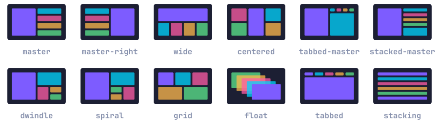

<p align="center">
  <picture>
    <source media="(prefers-color-scheme: dark)" srcset="docs/logo.svg">
    
  </picture>
</p>

<p align="center">
  Tiling layouts for <a href="https://swaywm.org">sway</a>, one per workspace.<br>
  Anything you arrange by hand wins over the layout.
</p>

<p align="center">
  <a href="#install">Install</a> ·
  <a href="docs/layouts.md">Layouts</a> ·
  <a href="docs/details.md">Details</a> ·
  <a href="ARCHITECTURE.md">Architecture</a>
</p>

<p align="center">


https://github.com/user-attachments/assets/933e5fc6-19ad-4b2f-ba2e-1004b448b6db


</p>

The animation above is drawn. Here is swaytiles in a real sway session:

https://github.com/user-attachments/assets/06af8569-7a35-4198-a915-d71e2e0efaaf

## Layouts

<a href="docs/layouts.md"></a>

Master and stack on either side or on top, centred master, dwindle,
spiral, grid, tabs, stacked titles and floating. Each workspace keeps
its own, and the [layouts page](docs/layouts.md) shows each one at work.

## Install

```sh
git clone https://github.com/sertacartun/swaytiles
cd swaytiles
./install.sh
```

The script copies swaytiles into `~/.local` and starts it as a systemd
user service. To update, run `git pull` and `./install.sh` again.

swaytiles now runs, and starts with every sway session. Your keys for
moving windows follow the layout. Add two lines to your sway config,
with keys you like, and reload sway (the script prints them too):

```
bindsym $mod+Shift+t exec ~/.local/bin/swaytiles menu --launcher fuzzel
bindsym $mod+m exec ~/.local/bin/swaytiles swap
```

The first opens the layout menu in the program named after `--launcher`:
fuzzel, rofi, wofi, tofi, bemenu, wmenu or dmenu. The second swaps the
focused window with the master.

New windows join the end of the stack. To have them open as the master
instead, as in dwm, run `swaytiles new master` once; `swaytiles new
stack` goes back.

## Uninstall

```sh
./install.sh --uninstall
```

Then remove the two lines from your sway config.

## More

- [Layouts](docs/layouts.md): each one with a demo.
- [Details](docs/details.md): what swaytiles leaves alone (changes made
  by hand, sizes, fullscreen, dialogs, several outputs), the commands,
  the move keys, the service, running without systemd.
- [Architecture](ARCHITECTURE.md): how it works.
